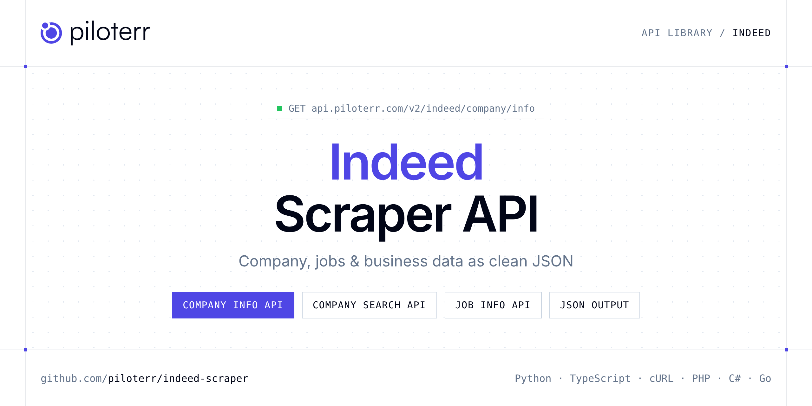

<p align="center">
  <a href="https://www.piloterr.com"></a>
</p>

# Indeed Scraper API

[](https://discord.gg/CFj3ph8aHU) [](https://app.piloterr.com) [](https://app.piloterr.com/openapi) [](LICENSE)

The **Piloterr Indeed Scraper API** lets you extract public data from Indeed as **clean, structured JSON** — no proxies, headless browsers or HTML parsing to maintain. Endpoints available in production:

- **Indeed Company Info API** — Indeed Company Info API.
- **Indeed Company Search API** — Indeed Company Search API.
- **Indeed Job Info API** — Indeed Job Info API.
- **Indeed Job Salary API** — Indeed Job Salary API.
- **Indeed Job Search API** — Indeed Job Search API.

Use it for lead generation, CRM enrichment, market mapping, investment research or job market analytics.

| Endpoint | Path | Credits | What you get |
|---|---|---|---|
| [Indeed Company Info API](#indeed-company-info-api) | `/v2/indeed/company/info` | 2 | Indeed Company Info API. Full employer profile by slug or URL. Browser rendering returns headcount, revenue, industry and FAQ or review blocks. |
| [Indeed Company Search API](#indeed-company-search-api) | `/v2/indeed/company/search` | 2 | Indeed Company Search API. Search fr.indeed.com employer profiles by keyword or URL. Browser rendering returns ratings, industry and profile links. |
| [Indeed Job Info API](#indeed-job-info-api) | `/v2/indeed/job/info` | 2 | Indeed Job Info API. Fetch a full job posting by viewjob URL, sponsored click URL or job key. Browser rendering returns description and structured salary. |
| [Indeed Job Salary API](#indeed-job-salary-api) | `/v2/indeed/job/salary` | 2 | Indeed Job Salary API. Career salary aggregates by job title slug or URL. Browser rendering returns median, percentiles and top paying cities. |
| [Indeed Job Search API](#indeed-job-search-api) | `/v2/indeed/job/search` | 2 | Indeed Job Search API. Search fr.indeed.com job listings by keyword or URL. Browser rendering returns cards with salary snippets and pagination. |

## Table of contents

- [How it works](#how-it-works)
- [Indeed Company Info API](#indeed-company-info-api)
- [Indeed Company Search API](#indeed-company-search-api)
- [Indeed Job Info API](#indeed-job-info-api)
- [Indeed Job Salary API](#indeed-job-salary-api)
- [Indeed Job Search API](#indeed-job-search-api)
- [Code examples in other languages](#code-examples-in-other-languages)
- [Practical use cases](#practical-use-cases)
- [Why Piloterr?](#why-piloterr)
- [FAQ](#faq)
- [Official SDKs](#official-sdks)
- [Related scrapers](#related-scrapers)
- [Support](#support)

## How it works

1. **Create a free Piloterr account** and copy your API key from the [dashboard](https://app.piloterr.com).
2. **Send a `GET` (or `POST`) request** to `https://api.piloterr.com/v2/...` with the header `x-api-key: YOUR_API_KEY`.
3. **Receive structured JSON** — Piloterr handles rendering, proxies, retries and parsing.

```bash
export PILOTERR_API_KEY="your-api-key"
pip install requests        # Python
# TypeScript: Node.js 18+ (native fetch), run with `npx tsx file.ts`
```

> Every endpoint accepts both `GET` (query string) and `POST` (JSON body with the same fields).

## Indeed Company Info API

Indeed Company Info API. Full employer profile by slug or URL. Browser rendering returns headcount, revenue, industry and FAQ or review blocks.

`GET | POST https://api.piloterr.com/v2/indeed/company/info` · **2 credits per request** · [Full reference](https://app.piloterr.com/openapi)

### Request parameters

| Parameter | Type | Required | Description |
|---|---|---|---|
| `query` | string | ✅ | Indeed company slug or full `/cmp/` URL. |
| `return_page_source` | boolean | — | When `true`, return the raw HTML as `{\"result\": \"...\"}` instead of structured JSON. Defaults to `false`. |

### Python example

```python
import json
import os
import requests

response = requests.get(
    "https://api.piloterr.com/v2/indeed/company/info",
    headers={"x-api-key": os.environ["PILOTERR_API_KEY"]},
    params={
        "query": "Proman-1",
    },
    timeout=120,
)
response.raise_for_status()
data = response.json()

print(json.dumps(data, indent=2, ensure_ascii=False)[:2000])
```

### TypeScript example

```typescript
type IndeedCompanyInfo = {
  founded?: unknown;
  revenue?: string;
  website?: string;
  industry?: string;
  logo_url?: string;
  company_url?: string;
  description?: string;
  headquarter?: string;
  staff_range?: string;
  company_name?: string;
  dynamic_sections?: {
    faq?: {
      faqs?: Record<string, unknown>[];
    };
  };
};

const params = new URLSearchParams({
  "query": "Proman-1",
});

const response = await fetch(`https://api.piloterr.com/v2/indeed/company/info?${params}`, {
  headers: { "x-api-key": process.env.PILOTERR_API_KEY! },
});
if (!response.ok) throw new Error(`Piloterr error ${response.status}: ${await response.text()}`);

const data = (await response.json()) as IndeedCompanyInfo;

console.log(JSON.stringify(data, null, 2).slice(0, 2000));
```

<details>
<summary><b>POST variant</b></summary>

```http
POST https://api.piloterr.com/v2/indeed/company/info
x-api-key: YOUR_API_KEY
Content-Type: application/json

{"query": "Proman-1"}
```
</details>

### Output example

Example response from the API reference, abridged — real values depend on the page you scrape.

```json
{
  "founded": null,
  "revenue": "$5B-$10B (USD)",
  "website": "https://www.proman.group/",
  "industry": "Ressources humaines et recrutement",
  "logo_url": "https://d2q79iu7y748jz.cloudfront.net/s/_squarelogo/96x96/298681ef47f10ca72cd94a73fdf47032",
  "company_url": "https://fr.indeed.com/cmp/Proman-1",
  "description": "Fondé à Manosque en 1990, PROMAN est aujourd’hui le 4ème acteur européen sur le marché du travail temporaire, du recrutement CDD/CDI et l…",
  "headquarter": "PROMAN: Siège social,\r\nZI Saint-Maurice\r\n04100 Manosque\r\n",
  "staff_range": "5001-10000",
  "company_name": "PROMAN",
  "dynamic_sections": {
    "faq": {
      "faqs": [
        {},
        {}
      ]
    }
  }
}
```

### Response fields

| Field | Type | Description |
|---|---|---|
| `founded` | object |  |
| `revenue` | string |  |
| `website` | string |  |
| `industry` | string |  |
| `logo_url` | string |  |
| `company_url` | string |  |
| `description` | string |  |
| `headquarter` | string |  |
| `staff_range` | string |  |
| `company_name` | string |  |
| `dynamic_sections` | object |  |
| `dynamic_sections.faq` | object |  |

## Indeed Company Search API

Indeed Company Search API. Search fr.indeed.com employer profiles by keyword or URL. Browser rendering returns ratings, industry and profile links.

`GET | POST https://api.piloterr.com/v2/indeed/company/search` · **2 credits per request** · [Full reference](https://app.piloterr.com/openapi)

### Request parameters

| Parameter | Type | Required | Description |
|---|---|---|---|
| `query` | string | ✅ | Company keyword or full Indeed companies search URL. |
| `return_page_source` | boolean | — | When `true`, return the raw HTML as `{\"result\": \"...\"}` instead of structured JSON. Defaults to `false`. |

### Python example

```python
import json
import os
import requests

response = requests.get(
    "https://api.piloterr.com/v2/indeed/company/search",
    headers={"x-api-key": os.environ["PILOTERR_API_KEY"]},
    params={
        "query": "airbus",
    },
    timeout=120,
)
response.raise_for_status()
data = response.json()

print(json.dumps(data, indent=2, ensure_ascii=False)[:2000])
```

### TypeScript example

```typescript
type IndeedCompanySearch = {
  results?: {
    rating?: number;
    industry?: string;
    jobs_url?: string;
    logo_url?: string;
    company_url?: string;
    description?: string;
    reviews_url?: string;
    company_name?: string;
    salaries_url?: string;
    reviews_count?: number;
  }[];
  pagination?: {
    next?: unknown;
    count?: number;
    has_next?: boolean;
  };
};

const params = new URLSearchParams({
  "query": "airbus",
});

const response = await fetch(`https://api.piloterr.com/v2/indeed/company/search?${params}`, {
  headers: { "x-api-key": process.env.PILOTERR_API_KEY! },
});
if (!response.ok) throw new Error(`Piloterr error ${response.status}: ${await response.text()}`);

const data = (await response.json()) as IndeedCompanySearch;

console.log(JSON.stringify(data, null, 2).slice(0, 2000));
```

<details>
<summary><b>POST variant</b></summary>

```http
POST https://api.piloterr.com/v2/indeed/company/search
x-api-key: YOUR_API_KEY
Content-Type: application/json

{"query": "airbus"}
```
</details>

### Output example

Example response from the API reference, abridged — real values depend on the page you scrape.

```json
{
  "results": [
    {
      "rating": 4.1,
      "industry": "Aérospatiale et défense",
      "jobs_url": "https://fr.indeed.com/cmp/Airbus-e4b213b1/jobs",
      "logo_url": "https://d2q79iu7y748jz.cloudfront.net/s/_squarelogo/64x64/7316c9e8fcda3af83c7321068c2f3a01",
      "company_url": "https://fr.indeed.com/cmp/Airbus-e4b213b1",
      "description": "We look to recruit, develop, grow and retain the best, and welcome ALL as an equal opportunity employer.",
      "reviews_url": "https://fr.indeed.com/cmp/Airbus-e4b213b1/reviews",
      "company_name": "Airbus",
      "salaries_url": "https://fr.indeed.com/cmp/Airbus-e4b213b1/salaries",
      "reviews_count": 2324
    },
    {
      "rating": 5,
      "industry": "ONG et associations à but non lucratif",
      "jobs_url": "https://fr.indeed.com/cmp/Cse-Airbus/jobs",
      "logo_url": null,
      "company_url": "https://fr.indeed.com/cmp/Cse-Airbus",
      "description": null,
      "reviews_url": "https://fr.indeed.com/cmp/Cse-Airbus/reviews",
      "company_name": "CSE AIRBUS",
      "salaries_url": "https://fr.indeed.com/cmp/Cse-Airbus/salaries",
      "reviews_count": 1
    }
  ],
  "pagination": {
    "next": null,
    "count": 6,
    "has_next": false
  }
}
```

### Response fields

| Field | Type | Description |
|---|---|---|
| `results[]` | object[] |  |
| `results[].rating` | number |  |
| `results[].industry` | string |  |
| `results[].jobs_url` | string |  |
| `results[].logo_url` | string |  |
| `results[].company_url` | string |  |
| `results[].description` | string |  |
| `results[].reviews_url` | string |  |
| `results[].company_name` | string |  |
| `results[].salaries_url` | string |  |
| `results[].reviews_count` | integer |  |
| `pagination` | object |  |
| `pagination.next` | object |  |
| `pagination.count` | integer |  |
| `pagination.has_next` | boolean |  |

## Indeed Job Info API

Indeed Job Info API. Fetch a full job posting by viewjob URL, sponsored click URL or job key. Browser rendering returns description and structured salary.

`GET | POST https://api.piloterr.com/v2/indeed/job/info` · **2 credits per request** · [Full reference](https://app.piloterr.com/openapi)

### Request parameters

| Parameter | Type | Required | Description |
|---|---|---|---|
| `query` | string | ✅ | Indeed job URL, sponsored SERP click URL or 16-char `jk` job key. |
| `return_page_source` | boolean | — | When `true`, return the raw HTML as `{\"result\": \"...\"}` instead of structured JSON. Defaults to `false`. |

### Python example

```python
import json
import os
import requests

response = requests.get(
    "https://api.piloterr.com/v2/indeed/job/info",
    headers={"x-api-key": os.environ["PILOTERR_API_KEY"]},
    params={
        "query": "585181841cb618e0",
    },
    timeout=120,
)
response.raise_for_status()
data = response.json()

print(json.dumps(data, indent=2, ensure_ascii=False)[:2000])
```

### TypeScript example

```typescript
type IndeedJobInfo = {
  url?: string;
  title?: string;
  salary?: unknown;
  job_key?: string;
  benefits?: unknown;
  job_type?: string;
  location?: string;
  company_url?: string;
  description?: string;
  remote_work?: unknown;
  company_name?: string;
  posted_today?: boolean;
  urgently_hiring?: boolean;
  remote_work_type?: unknown;
};

const params = new URLSearchParams({
  "query": "585181841cb618e0",
});

const response = await fetch(`https://api.piloterr.com/v2/indeed/job/info?${params}`, {
  headers: { "x-api-key": process.env.PILOTERR_API_KEY! },
});
if (!response.ok) throw new Error(`Piloterr error ${response.status}: ${await response.text()}`);

const data = (await response.json()) as IndeedJobInfo;

console.log(JSON.stringify(data, null, 2).slice(0, 2000));
```

<details>
<summary><b>POST variant</b></summary>

```http
POST https://api.piloterr.com/v2/indeed/job/info
x-api-key: YOUR_API_KEY
Content-Type: application/json

{"query": "585181841cb618e0"}
```
</details>

### Output example

Example response from the API reference, abridged — real values depend on the page you scrape.

```json
{
  "url": "https://fr.indeed.com/viewjob?jk=585181841cb618e0",
  "title": "Ingénieur Développeur Java F/H",
  "salary": null,
  "job_key": "585181841cb618e0",
  "benefits": null,
  "job_type": "CDI, Temps plein",
  "location": "Paris (75)",
  "company_url": "https://fr.indeed.com/cmp/Groupe-Intm?campaignid=mobvjcmp&from=mobviewjob&tk=1jsl3p16gjvko800&fromjk=585181841cb618e0",
  "description": "<div>\n <p>Depuis 2004, le Groupe INTM, entreprise de conseil et de services du numérique, accompagne ses clients dans leurs grands <b>pro…",
  "remote_work": null,
  "company_name": "INTM",
  "posted_today": false,
  "urgently_hiring": false,
  "remote_work_type": null
}
```

### Response fields

| Field | Type | Description |
|---|---|---|
| `url` | string |  |
| `title` | string |  |
| `salary` | object |  |
| `job_key` | string |  |
| `benefits` | object |  |
| `job_type` | string |  |
| `location` | string |  |
| `company_url` | string |  |
| `description` | string |  |
| `remote_work` | object |  |
| `company_name` | string |  |
| `posted_today` | boolean |  |
| `urgently_hiring` | boolean |  |
| `remote_work_type` | object |  |

## Indeed Job Salary API

Indeed Job Salary API. Career salary aggregates by job title slug or URL. Browser rendering returns median, percentiles and top paying cities.

`GET | POST https://api.piloterr.com/v2/indeed/job/salary` · **2 credits per request** · [Full reference](https://app.piloterr.com/openapi)

### Request parameters

| Parameter | Type | Required | Description |
|---|---|---|---|
| `query` | string | ✅ | Career salary slug, full `/career/.../salaries` URL or `slug\|location` pair. |
| `return_page_source` | boolean | — | When `true`, return the raw HTML as `{\"result\": \"...\"}` instead of structured JSON. Defaults to `false`. |

### Python example

```python
import json
import os
import requests

response = requests.get(
    "https://api.piloterr.com/v2/indeed/job/salary",
    headers={"x-api-key": os.environ["PILOTERR_API_KEY"]},
    params={
        "query": "ing\u00e9nieur-etudes-et-d\u00e9veloppement",
    },
    timeout=120,
)
response.raise_for_status()
data = response.json()

print(json.dumps(data, indent=2, ensure_ascii=False)[:2000])
```

### TypeScript example

```typescript
type IndeedJobSalary = {
  url?: string;
  title?: string;
  period?: string;
  salary?: {
    max?: number;
    min?: number;
    mean?: number;
    text?: string;
    type?: string;
    median?: number;
    num_data_points?: number;
  };
  country?: string;
  currency?: string;
  location?: string;
  by_period?: {
    DAILY?: {
      max?: number;
      min?: number;
      mean?: number;
      type?: string;
      median?: number;
      num_data_points?: number;
    };
    HOURLY?: {
      max?: number;
      min?: number;
      mean?: number;
      type?: string;
      median?: number;
      num_data_points?: number;
    };
    YEARLY?: {
      max?: number;
      min?: number;
      mean?: number;
      type?: string;
      median?: number;
      num_data_points?: number;
    };
    MONTHLY?: {
      max?: number;
      min?: number;
      mean?: number;
      type?: string;
      median?: number;
      num_data_points?: number;
    };
  };
  title_slug?: string;
  location_slug?: unknown;
  related_titles?: unknown;
  national_salary?: unknown;
  top_paying_cities?: {
    url?: string;
    salary?: unknown;
    currency?: string;
    location?: string;
    location_slug?: string;
  }[];
  top_paying_companies?: {
    salary?: {
      mean?: number;
      type?: string;
      count?: number;
    };
    company_url?: unknown;
    company_name?: string;
    reviews_count?: number;
  }[];
};

const params = new URLSearchParams({
  "query": "ing\u00e9nieur-etudes-et-d\u00e9veloppement",
});

const response = await fetch(`https://api.piloterr.com/v2/indeed/job/salary?${params}`, {
  headers: { "x-api-key": process.env.PILOTERR_API_KEY! },
});
if (!response.ok) throw new Error(`Piloterr error ${response.status}: ${await response.text()}`);

const data = (await response.json()) as IndeedJobSalary;

console.log(JSON.stringify(data, null, 2).slice(0, 2000));
```

<details>
<summary><b>POST variant</b></summary>

```http
POST https://api.piloterr.com/v2/indeed/job/salary
x-api-key: YOUR_API_KEY
Content-Type: application/json

{"query": "ingénieur-etudes-et-développement"}
```
</details>

### Output example

Example response from the API reference, abridged — real values depend on the page you scrape.

```json
{
  "url": "https://fr.indeed.com/career/ing%C3%A9nieur-etudes-et-d%C3%A9veloppement/salaries",
  "title": "Ingénieur Etudes Et Développement (H/F)",
  "period": "YEARLY",
  "salary": {
    "max": 69630.14,
    "min": 31076.39,
    "mean": 48879.51,
    "text": "46 517 €",
    "type": "YEARLY",
    "median": 46517.24,
    "num_data_points": 2269
  },
  "country": "FR",
  "currency": "EUR",
  "location": "France",
  "by_period": {
    "DAILY": {
      "max": 603.35,
      "min": 356.04,
      "mean": 473.4,
      "type": "DAILY",
      "median": 463.48,
      "num_data_points": 108
    },
    "HOURLY": {
      "max": 98.98,
      "min": 31.18,
      "mean": 61.49,
      "type": "HOURLY",
      "median": 55.56,
      "num_data_points": 18
    },
    "YEARLY": {
      "max": 69630.14,
      "min": 31076.39,
      "mean": 48879.51,
      "type": "YEARLY",
      "median": 46517.24,
      "num_data_points": 2269
    },
    "MONTHLY": {
      "max": 3509.6,
      "min": 1795.21,
      "mean": 2552.01,
      "type": "MONTHLY",
      "median": 2454.6,
      "num_data_points": 86
    }
  },
  "title_slug": "ing%C3%A9nieur-etudes-et-d%C3%A9veloppement",
  "location_slug": null,
  "related_titles": null,
  "national_salary": null,
  "top_paying_cities": [
    {
      "url": "https://fr.indeed.com/career/ing%C3%A9nieur-etudes-et-d%C3%A9veloppement/salaries/Paris",
      "salary": null,
      "currency": "EUR",
      "location": "Paris",
      "location_slug": "Paris"
    },
    {
      "url": "https://fr.indeed.com/career/ing%C3%A9nieur-etudes-et-d%C3%A9veloppement/salaries/Bordeaux",
      "salary": null,
      "currency": "EUR",
      "location": "Bordeaux",
      "location_slug": "Bordeaux"
    }
  ],
  "top_paying_companies": [
    {
      "salary": {
        "mean": 114.85,
        "type": "HOURLY",
        "count": 3
      },
      "company_url": null,
      "company_name": "Service Civique",
      "reviews_count": 12
    },
    {
      "salary": {
        "mean": 422,
        "type": "DAILY",
        "count": 5
      },
      "company_url": null,
      "company_name": "FREELANCE.COM",
      "reviews_count": 10
    }
  ]
}
```

### Response fields

| Field | Type | Description |
|---|---|---|
| `url` | string |  |
| `title` | string |  |
| `period` | string |  |
| `salary` | object |  |
| `salary.max` | number |  |
| `salary.min` | number |  |
| `salary.mean` | number |  |
| `salary.text` | string |  |
| `salary.type` | string |  |
| `salary.median` | number |  |
| `salary.num_data_points` | integer |  |
| `country` | string |  |
| `currency` | string |  |
| `location` | string |  |
| `by_period` | object |  |
| `by_period.DAILY` | object |  |
| `by_period.HOURLY` | object |  |
| `by_period.YEARLY` | object |  |
| `by_period.MONTHLY` | object |  |
| `title_slug` | string |  |
| `location_slug` | object |  |
| `related_titles` | object |  |
| `national_salary` | object |  |
| `top_paying_cities[]` | object[] |  |
| `top_paying_cities[].url` | string |  |

## Indeed Job Search API

Indeed Job Search API. Search fr.indeed.com job listings by keyword or URL. Browser rendering returns cards with salary snippets and pagination.

`GET | POST https://api.piloterr.com/v2/indeed/job/search` · **2 credits per request** · [Full reference](https://app.piloterr.com/openapi)

### Request parameters

| Parameter | Type | Required | Description |
|---|---|---|---|
| `query` | string | ✅ | Keyword, Indeed `/jobs` URL or SEO search URL on fr.indeed.com (default domain). |
| `page` | number | — | 1-based page number (10 results per page). Default: `1`. |
| `return_page_source` | boolean | — | When `true`, return the raw HTML as `{\"result\": \"...\"}` instead of structured JSON. Defaults to `false`. |

### Python example

```python
import json
import os
import requests

response = requests.get(
    "https://api.piloterr.com/v2/indeed/job/search",
    headers={"x-api-key": os.environ["PILOTERR_API_KEY"]},
    params={
        "query": "developpeur python",
    },
    timeout=120,
)
response.raise_for_status()
data = response.json()

print(json.dumps(data, indent=2, ensure_ascii=False)[:2000])
```

### TypeScript example

```typescript
type IndeedJobSearch = {
  results?: {
    url?: string;
    title?: string;
    salary?: unknown;
    job_key?: string;
    location?: string;
    sponsored?: boolean;
    attributes?: string[];
    company_name?: string;
  }[];
  pagination?: {
    next?: unknown;
    page?: number;
    count?: number;
    has_next?: boolean;
    per_page?: number;
    total_results?: number;
  };
};

const params = new URLSearchParams({
  "query": "developpeur python",
});

const response = await fetch(`https://api.piloterr.com/v2/indeed/job/search?${params}`, {
  headers: { "x-api-key": process.env.PILOTERR_API_KEY! },
});
if (!response.ok) throw new Error(`Piloterr error ${response.status}: ${await response.text()}`);

const data = (await response.json()) as IndeedJobSearch;

console.log(JSON.stringify(data, null, 2).slice(0, 2000));
```

<details>
<summary><b>POST variant</b></summary>

```http
POST https://api.piloterr.com/v2/indeed/job/search
x-api-key: YOUR_API_KEY
Content-Type: application/json

{"query": "developpeur python"}
```
</details>

### Output example

Example response from the API reference, abridged — real values depend on the page you scrape.

```json
{
  "results": [
    {
      "url": "https://fr.indeed.com/viewjob?jk=3d8672f2a39f7104",
      "title": "Développeur éditique - Confirmé (H/F)",
      "salary": null,
      "job_key": "3d8672f2a39f7104",
      "location": "Montreuil (93)",
      "sponsored": true,
      "attributes": [
        "CDI"
      ],
      "company_name": "GROUPE VILAVI"
    },
    {
      "url": "https://fr.indeed.com/viewjob?jk=2c4fb3fb8fcafad3",
      "title": "Business Développeur BtoB: Transition Énergétique (H/F/X)",
      "salary": {
        "text": "36 000 € par an"
      },
      "job_key": "2c4fb3fb8fcafad3",
      "location": "Télétravail partiel à 75017 Paris 17e",
      "sponsored": true,
      "attributes": [
        "Temps plein + 1"
      ],
      "company_name": "JOVYN"
    }
  ],
  "pagination": {
    "next": null,
    "page": 1,
    "count": 15,
    "has_next": false,
    "per_page": 10,
    "total_results": 1264
  }
}
```

### Response fields

| Field | Type | Description |
|---|---|---|
| `results[]` | object[] |  |
| `results[].url` | string |  |
| `results[].title` | string |  |
| `results[].salary` | object |  |
| `results[].job_key` | string |  |
| `results[].location` | string |  |
| `results[].sponsored` | boolean |  |
| `results[].attributes` | string[] |  |
| `results[].company_name` | string |  |
| `pagination` | object |  |
| `pagination.next` | object |  |
| `pagination.page` | integer |  |
| `pagination.count` | integer |  |
| `pagination.has_next` | boolean |  |
| `pagination.per_page` | integer |  |
| `pagination.total_results` | integer |  |

## Code examples in other languages

Ready-to-run examples live in the [`examples/`](examples) folder. Each one reads your key from the `PILOTERR_API_KEY` environment variable.

| Language | Company Info | Company Search | Job Info | Job Salary | Job Search |
|---|---|---|---|---|---|
| cURL (Bash) | [`company-info`](examples/curl/company_info.sh) | [`company-search`](examples/curl/company_search.sh) | [`job-info`](examples/curl/job_info.sh) | [`job-salary`](examples/curl/job_salary.sh) | [`job-search`](examples/curl/job_search.sh) |
| PHP | [`company-info`](examples/php/company_info.php) | [`company-search`](examples/php/company_search.php) | [`job-info`](examples/php/job_info.php) | [`job-salary`](examples/php/job_salary.php) | [`job-search`](examples/php/job_search.php) |
| C# | [`company-info`](examples/csharp/CompanyInfo.cs) | [`company-search`](examples/csharp/CompanySearch.cs) | [`job-info`](examples/csharp/JobInfo.cs) | [`job-salary`](examples/csharp/JobSalary.cs) | [`job-search`](examples/csharp/JobSearch.cs) |
| Go | [`company-info`](examples/go/company_info.go) | [`company-search`](examples/go/company_search.go) | [`job-info`](examples/go/job_info.go) | [`job-salary`](examples/go/job_salary.go) | [`job-search`](examples/go/job_search.go) |
| Java | [`company-info`](examples/java/CompanyInfoExample.java) | [`company-search`](examples/java/CompanySearchExample.java) | [`job-info`](examples/java/JobInfoExample.java) | [`job-salary`](examples/java/JobSalaryExample.java) | [`job-search`](examples/java/JobSearchExample.java) |
| Ruby | [`company-info`](examples/ruby/company_info.rb) | [`company-search`](examples/ruby/company_search.rb) | [`job-info`](examples/ruby/job_info.rb) | [`job-salary`](examples/ruby/job_salary.rb) | [`job-search`](examples/ruby/job_search.rb) |
| Node.js | [`company-info`](examples/nodejs/company_info.mjs) | [`company-search`](examples/nodejs/company_search.mjs) | [`job-info`](examples/nodejs/job_info.mjs) | [`job-salary`](examples/nodejs/job_salary.mjs) | [`job-search`](examples/nodejs/job_search.mjs) |

## Practical use cases

- **Lead generation** — Build target account lists from public company data.
- **CRM enrichment** — Keep firmographics, websites and descriptions up to date.
- **Market mapping** — Map competitors and segments across countries and industries.
- **Investment research** — Screen companies, funding and signals for deal flow.
- **Job market analytics** — Track hiring, roles and salaries where available.

## Why Piloterr?

- **No infrastructure** — no proxies, headless browsers or CAPTCHA solving to run yourself.
- **Structured JSON** — stable, documented fields instead of brittle HTML selectors.
- **Pay per request** — transparent credit cost per endpoint, failed requests are retried for you.
- **One API key, hundreds of sources** — Indeed plus many other e-commerce, search and company data endpoints in the [Piloterr library](https://www.piloterr.com/library).
- **Any language** — plain HTTPS + JSON, with examples for Python, TypeScript, cURL, PHP, C#, Go, Java, Ruby and Node.js.

## FAQ

### Is it legal to scrape Indeed?

Collecting publicly available data is generally allowed in many jurisdictions, but rules depend on your country, the data you collect and how you use it. Avoid personal data unless you have a lawful basis, respect the website's terms where they apply, and get legal advice for your specific use case. This is not legal advice.

### Do I need proxies or a headless browser?

No. Piloterr handles rendering, proxy rotation and retries on its side. You only send an HTTPS request with your `x-api-key` header and receive JSON.

### How much does a request cost?

Credits per call: `/v2/indeed/company/info` **2**, `/v2/indeed/company/search` **2**, `/v2/indeed/job/info` **2**, `/v2/indeed/job/salary` **2**, `/v2/indeed/job/search` **2**. See the [Piloterr website](https://www.piloterr.com) for plans.

### What data does the Indeed API return?

Each endpoint returns structured JSON: **Indeed Company Info** — `founded`, `revenue`, `website`, `industry`, `logo_url`, `company_url`; **Indeed Company Search** — `results[]`, `results[].rating`, `results[].industry`, `results[].jobs_url`, `results[].logo_url`, `results[].company_url`; **Indeed Job Info** — `url`, `title`, `salary`, `job_key`, `benefits`, `job_type`; **Indeed Job Salary** — `url`, `title`, `period`, `salary`, `salary.max`, `salary.min`.

### How do I paginate Indeed results?

Use the `page` parameter and keep requesting while the response indicates more results.

### Can I get the raw HTML instead of JSON?

Yes. Set `return_page_source=true` and the response becomes `{"result": "..."}` with the page source.

### Which languages are supported?

Any language that can make an HTTP request. This README shows Python and TypeScript; the [`examples/`](examples) folder contains cURL, PHP, C#, Go, Java, Ruby and Node.js.

## Official SDKs

Use Piloterr from your own language with a typed client:

| SDK | Package | Install |
| --- | --- | --- |
| Node.js | [`@piloterr/sdk`](https://www.npmjs.com/package/@piloterr/sdk) | `npm install @piloterr/sdk` |
| Python | [`piloterr`](https://pypi.org/project/piloterr/) | `pip install piloterr` |
| Go | [`piloterr-go`](https://pkg.go.dev/github.com/piloterr/piloterr-go) | `go get github.com/piloterr/piloterr-go` |
| .NET | [`Piloterr`](https://www.nuget.org/packages/Piloterr) | `dotnet add package Piloterr` |
| Ruby | [`piloterr`](https://rubygems.org/gems/piloterr) | `gem install piloterr` |
| PHP | [`piloterr/sdk`](https://packagist.org/packages/piloterr/sdk) | `composer require piloterr/sdk` |
| Java | [`piloterr-java`](https://github.com/piloterr/piloterr-java) | build from source, see its README |
| CLI | [`@piloterr/cli`](https://www.npmjs.com/package/@piloterr/cli) | `npm install -g @piloterr/cli` |
| MCP server | [`@piloterr/mcp`](https://www.npmjs.com/package/@piloterr/mcp) | `npx -y @piloterr/mcp` |

## Related scrapers

- [Company Database Scraper API](https://github.com/piloterr/company-data-api)
- [Crunchbase Scraper API](https://github.com/piloterr/crunchbase-scraper)
- [Europages Scraper API](https://github.com/piloterr/europages-scraper)
- [Fiverr Scraper API](https://github.com/piloterr/fiverr-scraper)
- [G2 Scraper API](https://github.com/piloterr/g2-scraper)
- [GitHub Scraper API](https://github.com/piloterr/github-scraper)
- [All Piloterr scrapers on GitHub](https://github.com/piloterr)

## Support

- 💬 Join the [Piloterr Discord](https://discord.gg/CFj3ph8aHU) to ask questions and share what you build.
- 📚 Browse the [API reference (OpenAPI)](https://app.piloterr.com/openapi) and the [Piloterr library](https://www.piloterr.com/library).
- 🔑 [Get your API key](https://app.piloterr.com).

---

<p align="center">
  <a href="https://www.piloterr.com">
    <picture>
      <source media="(prefers-color-scheme: dark)" srcset="images/logo-dark.svg">
      
    </picture>
  </a>
  <br>
  <sub>Built by <a href="https://www.piloterr.com">Piloterr</a> — web scraping APIs for e-commerce, search, real estate and more, one API key.</sub>
</p>

<sub>Indeed is a trademark of its respective owner. This repository is not affiliated with or endorsed by Indeed. Examples are released under the MIT license.</sub>
